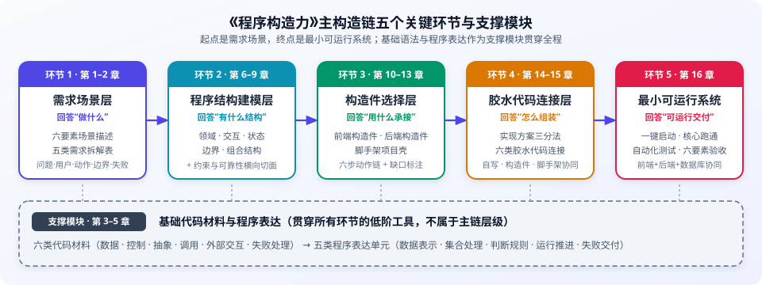

本附录汇总主构造链五个关键环节和支撑模块的所有条目。

## 主构造链五个关键环节总表

| 需求场景层 | 程序结构建模层 | 构造件选择层 | 胶水代码连接层 | 最小可运行系统层 |
|-----------|--------------|------------|--------------|----------------|
| 问题 | 领域结构 | 前端构造件 | 配置胶水 | 启动 |
| 用户 | 交互结构 | 后端构造件 | 路由胶水 | 输入 |
| 动作 | 状态结构 | 脚手架构造件 | 依赖胶水 | 输出 |
| 输入 | 边界结构 | — | 数据转换胶水 | 运行 |
| 输出 | 组合结构 | — | 适配器胶水 | 测试 |
| 失败 | 约束与可靠性切面 | — | 错误处理胶水 | 验收 |

## 支撑模块

### 基础代码材料与程序表达（第 3-5 章）

说明：支撑模块贯穿主构造链所有层，不参与主链编号。

#### 六类代码材料

| 类别 | 核心构造 | 解决的问题 |
|------|---------|-----------|
| 数据材料 | 变量、列表、字典、字符串、数字 | 存储和表示数据 |
| 控制材料 | `if`、`for`、`while`、`break`、`continue` | 改变执行流程 |
| 抽象材料 | `def`、`class`、`lambda` | 包装命名操作集 |
| 调用材料 | 函数调用、方法调用、运算符 | 触发已定义的抽象 |
| 外部交互材料 | 文件读写、模块导入、打印输入 | 与外部世界交换数据 |
| 失败处理材料 | `try/except`、`raise`、`finally` | 异常情况下保持可控 |

#### 五类程序表达单元

| 类别 | 表达单元 |
|------|---------|
| 数据表示表达 | 表示、字段、关系、集合、配置、结果 |
| 集合处理表达 | 遍历、筛选、转换、查找、映射、分组、排序、聚合 |
| 判断与规则表达 | 条件、规则、验证、权限、限制、触发 |
| 运行推进表达 | 状态、状态变化、动作、流程 |
| 失败与交付表达 | 失败、恢复、输出、反馈 |

---

## 按关键环节汇总

### 需求场景层（第 1-2 章）

| 要素 | 描述 | Task Manager 示例 |
|------|------|-------------------|
| 问题 | 程序解决什么真实问题 | 团队缺乏统一任务追踪 |
| 用户 | 谁用这个系统 | Member, Manager, Admin |
| 动作 | 每个角色做什么 | 创建、分配、完成、审核 |
| 输入 | 系统接收什么数据 | title, description, priority, due_date |
| 输出 | 系统输出什么结果 | 任务对象、错误响应 |
| 失败 | 哪些失败必须处理 | 验证错误、状态冲突、系统错误 |

### 程序结构建模层（第 6-9 章）

| 结构类别 | 解决的问题 | 结构规格 | 产物形式 |
|---------|-----------|---------|---------|
| 领域结构 | 程序有什么事物 | 对象卡片、字段说明、关系表、生命周期 | 结构化定义表 |
| 交互结构 | 谁可以做什么 | 用户动作表、系统事件表、命令/查询 | 动作规格表 |
| 状态结构 | 什么会变化 | 状态拥有者表、状态转移表 | 状态转移图 |
| 边界结构 | 数据从哪进出 | 边界定义表、输入输出契约 | 接口规格表 |
| 组合结构 | 各部分如何组织 | 组件树、模块结构、服务结构 | 层级结构图 |
| 约束与可靠性 | 哪些限制和保证 | 约束表、可靠性策略表 | 横向切面检查表 |

### 构造件选择层（第 10-13 章）

| 构造件类别 | 构造件 | 承接的结构 |
|-----------|--------|-----------|
| 前端框架 | React / Vue / Svelte | 组件组合结构 |
| 组件库 | MUI / Ant Design / shadcn/ui | UI 展示结构 |
| 路由库 | React Router / Vue Router | 页面流转结构 |
| 状态库 | Redux / Zustand / Pinia | 全局共享状态结构 |
| 请求库 | TanStack Query / SWR / Apollo | 服务端数据状态结构 |
| 表单库 | React Hook Form | 输入交互结构 |
| 验证库 | Zod / Yup / Pydantic | 字段约束结构 |
| Web 框架 | FastAPI / Express / Spring Boot | API 入口结构 |
| ORM | SQLAlchemy / Prisma / TypeORM | 数据访问结构 |
| 任务队列 | Celery / BullMQ | 异步任务结构 |
| 测试框架 | pytest / Vitest / Jest | 测试验证结构 |
| 脚手架 | Vite / Next.js / create-app | 工程壳结构 |

### 胶水代码连接层（第 14-15 章）

| 实现方式 | 描述 | 胶水代码类型 |
|---------|------|------------|
| 自写代码 | 业务逻辑、领域约束 | 配置胶水、路由胶水 |
| 构造件使用 | 通用结构用库/框架承接 | 依赖胶水、数据转换胶水 |
| 脚手架 | 项目壳 | 适配器胶水、错误处理胶水 |

### 最小可运行系统层（第 16 章）

详见附录 F：最小可运行系统检查表。

---

## 主构造链递进关系

