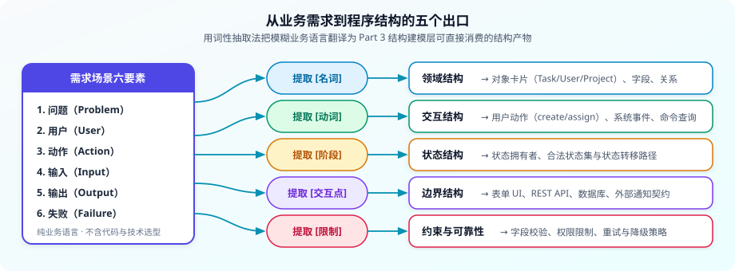

## 本章问题

拿到一个需求后，你的第一反应是什么？很多人第一反应是选框架、搭项目壳、写代码。但这是倒置的。第一件事应该是搞清楚：这个程序要解决什么问题、谁使用它、用户要做什么、系统要接收什么输入、输出什么结果、哪些失败必须处理。

## 背景：为什么这章重要

传统编程教学从语法开始。变量、条件、循环、函数——学完这些后给你一个需求，你试图用语法去堆出程序。这条路的问题是：语法不包含需求上下文。你不会因为知道 `for` 怎么写就知道这个程序要解决什么问题。

需求场景层（Demand Scenario Layer）是主构造链的第一个关键环节。它不是代码层，也不是设计层——它是建立程序构造的**真正的起点**。

这一层不写代码。这一层做的事是：把模糊的、口头的、文档化的需求，变成一个结构化的场景描述。这个描述是后续所有工作的输入。没有清晰的需求场景，后面的结构建模、构造件选择、代码组装都是在打靶但没有靶心。

## 核心内容

### 需求场景层的定义

需求场景层解决的核心问题：程序要解决的**真实世界问题是什么**。

| 维度 | 说明 |
|------|------|
| 解决的问题 | 明确程序的目标、用户、动作、输入、输出和失败条件 |
| 输入 | 模糊的需求描述（口头、文档、Issue） |
| 输出 | 结构化的六要素场景描述 |
| 边界 | 不涉及技术选型、代码结构、UI 设计 |
| 取舍 | 场景描述越精确，后续结构建模越容易；但过度细化会提前陷入实现细节 |

**输入**：老板说"做个任务管理系统"——这是一句需求。

**输出**：一份六要素场景描述——谁用系统做什么、输入什么、输出什么、失败了怎么办。

### 需求场景的六要素

一个完整的需求场景包含六个要素。缺任何一个，后续的结构建模都会出现盲区。

#### 1. 问题（Problem）

程序要解决的**核心问题**是什么？一句话说清楚。

```
❌ 我们要做一个任务管理系统。
✅ 团队目前没有统一的任务追踪方式，任务经常遗漏或重复。
```

问题描述决定程序的价值。如果问题不清晰，后续所有设计都没有判断标准。

#### 2. 用户（User）

谁使用这个程序？列出所有角色。

```
❌ 用户是团队成员。
✅ 角色：团队成员（创建和执行任务）、团队负责人（分配和审核任务）、系统管理员（管理用户和配置）。
```

不同角色有不同的动作、权限和视图。角色遗漏是需求场景最常见的缺陷。

#### 3. 动作（Action）

每个角色要做什么？列出所有用户动作。

```
❌ 用户管理任务。
✅ 团队成员：创建任务、查看任务列表、更新任务状态、评论任务。
   团队负责人：分配任务、审核任务完成、查看团队进度。
   系统管理员：管理用户、管理项目、查看系统日志。
```

动作是后续交互结构和状态结构的主要来源。遗漏动作意味着后续结构建模会缺路径。

#### 4. 输入（Input）

系统从外部接收什么数据？

```
❌ 用户输入任务信息。
✅ 创建任务时接收：标题（必填，1-200 字符）、描述（可选，最长 2000 字符）、优先级（低/中/高/紧急）、截止日期（可选）。
```

输入决定边界结构。没有输入规格，边界结构无法定义校验逻辑。

#### 5. 输出（Output）

系统向外部输出什么结果？

```
❌ 显示任务列表。
✅ 任务列表 API 返回：任务 ID、标题、状态、优先级、负责人、创建时间、截止时间。
   错误时返回：错误码、错误信息、可选的详细验证失败列表。
```

输出决定 API 契约和 UI 展示结构。

#### 6. 失败（Failure）

哪些失败必须处理？

```
❌ 系统出错时显示错误。
✅ 创建任务时标题为空 → 返回验证错误。
   分配任务给不存在的用户 → 返回用户不存在错误。
   数据库写入失败 → 重试 3 次后返回系统错误。
   通知发送失败 → 记录日志，不阻断主流程。
```

失败不是异常情况——失败是所有程序都必须处理的预期路径。不列失败清单，就不算完整的需求场景。

### 需求场景六要素检查表

| 要素 | 识别动作 | 必须明确的答案 |
|------|---------|--------------|
| 问题 | 写出一句话描述程序解决什么真实问题 | 一句话核心问题 |
| 用户 | 列出所有使用该系统的角色 | 至少一个角色定义 |
| 动作 | 为每个角色列出他们要做的操作 | 每个角色的动作列表 |
| 输入 | 列出系统从外部接收的每项数据 | 每个输入的格式和约束 |
| 输出 | 列出系统返回给外部的每种结果 | 成功和失败的输出格式 |
| 失败 | 列出至少三个必须处理的失败场景 | 至少 3 个失败场景 |

### 需求场景和代码材料的区别

需求场景层不出现代码，不出现 `dict`、`class` 或 `def`，只使用业务语言。

::: {.callout-tip title="业务语言 vs 技术方案"}
- **反例（技术方案过早介入）**：用户通过 `POST /tasks` 提交 JSON 格式的任务数据。
- **正例（纯需求场景描述）**：用户填写任务标题、描述和优先级，点击“创建”按钮。
:::

代码出现在后续环节。需求场景层只回答“做什么”，不回答“怎么做”。

::: {.content-visible when-format="html"}
<div class="pcf-toy" data-toy="ch1-req-vs-tech"></div>
:::

### 需求场景到程序结构建模的入口

需求场景层不是终点，而是主构造链的入口。六要素各自映射到程序结构建模层的不同结构：



这个映射将在第 2 章完整展开。本章的核心任务是建立“需求场景是起点”的工程认知。

::: {.content-visible when-format="html"}
<div class="pcf-toy" data-toy="ch1-six-elements"></div>
:::

## 例子与实践

### 场景：任务管理系统 Task Manager 的需求场景

贯穿全书的例子是一个任务管理系统。下面写出它的需求场景。

**问题**：团队缺乏统一的任务追踪方式。任务通过口头、IM 消息、邮件散布，没有集中管理。任务被遗漏、重复创建、进度不可追踪。

**用户与角色**：
- 团队成员（Member）：创建任务、查看任务列表、更新自己任务的状态、评论任务
- 团队负责人（Manager）：分配任务给成员、审核任务完成、查看团队所有任务
- 系统管理员（Admin）：管理用户账号、管理项目分类、查看系统日志

**动作用例**：

| 角色 | 动作 | 触发条件 | 预期结果 |
|------|------|---------|---------|
| Member | 创建任务 | 有新工作需要记录 | 任务进入待分配状态 |
| Manager | 分配任务 | 任务待分配，适合的成员已确定 | 任务进入执行状态 |
| Member | 完成任务 | 工作完成 | 任务进入待审核状态 |
| Manager | 审核任务 | 任务完成待审核 | 任务进入已完成状态 |
| Member | 评论任务 | 需要对任务发表意见 | 评论被记录并通知相关人员 |
| Admin | 管理用户 | 需要添加/移除团队成员 | 用户被添加或移除 |
| 系统 | 发送通知 | 任务状态变化 | 通知相关人员 |

**输入规格**：

| 动作 | 输入字段 | 约束 |
|------|---------|------|
| 创建任务 | title（必填） | 1-200 字符 |
| 创建任务 | description（可选） | 0-2000 字符 |
| 创建任务 | priority（必填） | low / medium / high / urgent |
| 创建任务 | due_date（可选） | 日期格式，不早于今天 |
| 分配任务 | task_id + assignee_id | assignee 必须是有效用户 |
| 评论任务 | task_id + content | content 1-1000 字符 |

**输出规格**：

| 场景 | 输出内容 |
|------|---------|
| 创建任务成功 | task 对象（含自动生成的 id、created_at） |
| 创建任务失败（验证） | 错误码: VALIDATION_ERROR + 失败字段列表 |
| 分配成功 | task 对象（status 更新为 in_progress） |
| 分配失败（用户不存在） | 错误码: NOT_FOUND |
| 操作成功 | 标准成功响应 |
| 系统内部错误 | 错误码: INTERNAL_ERROR |

**失败场景**：

| 失败场景 | 处理方式 |
|---------|---------|
| 标题为空 | 返回验证错误，不创建任务 |
| 分配给不存在的用户 | 返回用户不存在错误 |
| 状态转移非法（如从 closed 直接到 done） | 返回状态冲突错误 |
| 数据库写入失败 | 重试 3 次，全部失败返回系统错误 |
| 通知发送失败 | 记录日志，不阻断主流程 |

### 六要素检查

| 要素 | Task Manager 的答案 |
|------|-------------------|
| 问题 | 团队任务缺乏统一追踪 |
| 用户 | Member, Manager, Admin |
| 动作 | 创建、分配、完成、审核、评论、通知 |
| 输入 | 标题、描述、优先级、截止日期 |
| 输出 | 任务对象、错误响应 |
| 失败 | 验证错误、状态冲突、数据库失败、通知失败 |

## 小结

需求场景层是主构造链的第一个关键环节。它不写代码，不做设计，只做一件事：把模糊的需求变成结构化的六要素场景描述。

问题、用户、动作、输入、输出、失败——六个要素缺一不可。缺了任何一个，后续的结构建模都会出现盲区。完成了需求场景层，你才真正知道：这个程序要解决什么问题。

下一章做的事：把需求场景中的六个要素，拆成程序结构建模层可以消费的五类结构。

## 本章产物

完成本章后，你拥有以下可交付产物：

- **六要素需求场景描述**（覆盖问题、用户、动作、输入、输出与失败场景）
- **需求场景六要素检查表**（用于评审需求完整性）

可复用空白模板见[附录 B · 模板 1：需求场景六要素记录表](appendix-b-structure-modeling-template.qmd#模板-1需求场景六要素记录表)。


## 从业者输出

完成本章后，你能做三件事：

第一，对一个模糊的需求写出六要素场景描述。拿到一句"做个任务管理系统"后，你能写出问题、用户、动作、输入、输出、失败六个维度的结构化描述。

第二，用六要素检查表评估一个现有的需求文档。你能标出哪些要素已覆盖、哪些要素有遗漏——最常见的遗漏是失败场景和输入约束。

第三，区分"需求场景"和"技术方案"。你能判断一句描述是属于需求场景层（"用户要创建任务"）还是属于技术方案层（"用 POST /tasks API"），并坚持在需求场景层不讨论技术实现。

产出物是一份六要素场景描述。它不是代码，也不是设计文档——它是程序构造的真正起点。
