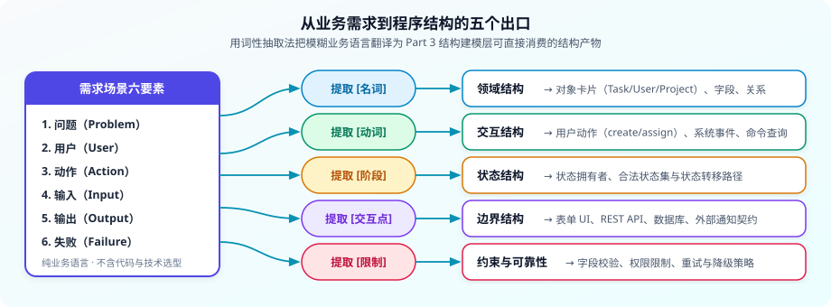

## 本章问题

需求场景的六要素描述清楚了程序要做什么，但程序不能直接消费"用户创建任务"这样的描述。程序需要的是结构化的规格——对象是什么、动作有什么、状态怎么变化、边界在哪里、约束是什么。怎么把一个业务描述变成程序可以承接的结构？

## 背景：为什么这章重要

第 1 章产出了需求场景的六要素描述。但需求场景是业务语言，程序需要的是结构语言。

业务语言说"用户创建任务"。程序结构语言需要把这个翻译成：
- 有一个 Task 对象
- 有一个 create 动作
- 任务创建后进入 open 状态
- 标题不能为空（约束）
- 数据从表单进入系统（边界）

没有这个翻译阶段，你会直接从需求跳到代码——结果写出来的代码和业务描述对不上。

这一章建立第一层转换：从需求场景到程序结构的五个出口。



这五个出口对应 Part 3 的程序结构建模层。本章的核心动作只有一件：把需求场景里的业务语言，分别归入这五个出口。

## 核心内容

### 为什么需求不能直接写代码

需求不能直接写代码的两个原因：

第一，需求的粒度不统一。一句"用户管理任务"包含了多个动作（创建、查看、更新、删除）和多个对象（任务、用户）。直接翻译成代码会少东西。

第二，需求隐含的结构需要显式化。"分配给负责人"隐含了"任务有 assignee 字段，assignee 引用 User 对象，分配后任务状态变为 in_progress"。需求不写这些，但程序需要。

拆解需求就是把隐含的结构变成显式的规格。

### 从需求抽取五类结构的方法

#### 方法 1：名词 → 领域结构

把需求描述中所有**名词和名词短语**列出来。排除技术名词，只留业务名词。

输入（以 Task Manager 为例）：

```text
任务、用户、项目、标题、描述、优先级、截止日期、负责人、评论、状态
```

处理每个名词的三步：
- 第一步，标记独立事物，生成对象卡片。
- 第二步，标记事物特征，生成字段说明。
- 第三步，标记对象之间的关联，生成对象关系表。

| 名词 | 判定 | 结构产物 |
|------|------|---------|
| 任务 | 独立事物 | 对象卡片 Task |
| 用户 | 独立事物 | 对象卡片 User |
| 项目 | 独立事物 | 对象卡片 Project |
| 标题 | Task 的特征 | 字段 title |
| 描述 | Task 的特征 | 字段 description |
| 优先级 | Task 的特征 | 字段 priority |
| 截止日期 | Task 的特征 | 字段 due_date |
| 负责人 | Task 关联 User | 关系 assignee |
| 评论 | 独立事物 | 对象卡片 Comment（或作为 Task 的嵌入） |
| 状态 | Task 的特征 | 字段 status + 状态结构 |

#### 方法 2：动词 → 交互结构

把需求描述中所有**动词或动词短语**列出来。区分用户发起的动作和系统自动执行的事件。

输入：

```text
创建任务、分配任务、完成任务、审核任务、评论任务、取消任务、管理用户、发送通知、超时关闭
```

处理每个动词的三步：
- 第一步，标记发起者，区分用户动作和系统事件。
- 第二步，标记操作对象，关联到对象卡片。
- 第三步，标记执行后的状态变化，关联到状态结构。

| 动词 | 发起者 | 操作对象 | 结构产物 |
|------|--------|---------|---------|
| 创建任务 | Member | Task | 用户动作 create_task |
| 分配任务 | Manager | Task | 用户动作 assign_task |
| 完成任务 | Member | Task | 用户动作 complete_task |
| 审核任务 | Manager | Task | 用户动作 approve_task |
| 评论任务 | Member | Task | 用户动作 comment_task |
| 取消任务 | Member/Manager | Task | 用户动作 cancel_task |
| 管理用户 | Admin | User | 用户动作 manage_user |
| 发送通知 | 系统 | - | 系统事件 send_notification |
| 超时关闭 | 系统 | Task | 系统事件 auto_close |

#### 方法 3：阶段 → 状态结构

把需求描述中所有**阶段、状态、状态变化**列出来。一个对象从创建到销毁经历了哪些阶段。

输入：

```text
待分配、执行中、待审核、已完成、已关闭、失败
```

处理阶段的三步：
- 第一步，标记属于哪个对象，确定状态拥有者。
- 第二步，标记状态之间的转移，生成状态转移图。
- 第三步，标记每个状态下允许的动作，确定动作权限。

| 状态 | 属于 | 含义 |
|------|------|------|
| open | Task | 待分配 |
| in_progress | Task | 执行中 |
| pending_review | Task | 待审核 |
| done | Task | 已完成 |
| closed | Task | 已关闭 |
| failed | Task | 执行失败 |

方法：列出所有状态，画出转移路径，标注合法转移。

#### 方法 4：交互点 → 边界结构

把需求描述中所有**系统与外部交互的点**列出来。包括输入来源和输出目标。

输入：

```text
用户通过表单创建任务、系统通过邮箱发送通知、数据存在数据库、管理员通过页面管理用户
```

处理每个交互点的两步动作：
- 标记数据进入系统的来源，归入**输入边界**。
- 标记数据离开系统的目标，归入**输出边界**。

| 交互点 | 方向 | 边界类型 | 结构产物 |
|--------|------|---------|---------|
| 用户填写表单 | 输入 | UI 边界 | 表单边界 |
| API 调用 | 输入/输出 | API 边界 | 接口契约 |
| 数据库 | 存储 | 数据边界 | 数据访问边界 |
| 邮箱通知 | 输出 | 外部服务边界 | 通知边界 |
| 日志系统 | 输出 | 观测边界 | 日志边界 |

#### 方法 5：限制 → 约束与可靠性切面

把需求描述中所有**限制、规则、条件、假设**列出来。

输入：

```text
标题不能为空、优先级必须四选一（low/medium/high/urgent）、只有负责人可以完成任务、任务超过 30 天自动关闭、状态变化必须按顺序
```

处理每个限制的两步动作：
- 标记该限制作用的对象或流程，确定归属的结构类别。
- 明确违反该限制时的系统响应，写入可靠性策略。

| 限制 | 归属结构 | 处理方式 |
|------|---------|---------|
| 标题不能为空 | 领域结构（字段约束） | 验证错误 |
| 优先级必须四选一（low/medium/high/urgent） | 领域结构（字段约束） | 验证错误 |
| 只有负责人可以完成 | 交互结构（权限约束） | 权限错误 |
| 30 天自动关闭 | 状态结构（状态转移） | 定时任务 |
| 状态变化必须按顺序 | 状态结构（转移约束） | 状态冲突错误 |

### 需求拆解五类表

以下是一份完整的从需求描述到五类结构的映射表：

| 需求陈述 | 类别 | 结构产物 |
|---------|------|---------|
| "每个任务有标题" | 名词 → 领域结构 | Task.title 字段 |
| "任务可以分配给成员" | 名词 → 领域结构 | Task.assignee → User 关系 |
| "任务有状态" | 阶段 → 状态结构 | Task.status + 状态定义 |
| "成员可以创建任务" | 动词 → 交互结构 | create_task 动作 |
| "任务创建后待分配" | 阶段 → 状态结构 | open 状态 |
| "通过表单提交任务" | 交互点 → 边界结构 | 表单输入边界 |
| "标题不能为空" | 限制 → 约束 | title 字段验证 |
| "通知发送失败记录日志" | 限制 → 可靠性 | 通知失败降级策略 |

### 需求到结构映射模板

以下模板可以直接用于拆解一个需求的五类结构：

**需求陈述**：_______________

| 分析维度 | 需求中的内容 | 提取方式 | 结构产物 |
|---------|-------------|---------|---------|
| 名词 | ________ | 列出所有业务名词 | 对象卡片 / 字段 / 关系 |
| 动词 | ________ | 列出所有动作 | 用户动作 / 系统事件 |
| 阶段 | ________ | 列出所有状态 | 状态定义 / 状态转移 |
| 交互点 | ________ | 列出所有输入输出点 | 边界定义 |
| 限制 | ________ | 列出所有规则条件 | 约束 / 可靠性策略 |

::: {.content-visible when-format="html"}
<div class="pcf-toy" data-toy="ch2-pos-extractor"></div>
:::

## 例子与实践

### 场景：Task Manager 的需求拆解

使用第 1 章的 Task Manager 需求场景，应用五类拆解方法。

**第一步：从需求描述中提取名词 → 领域结构**

名词列表：任务、用户、项目、标题、描述、优先级、截止日期、负责人、评论、状态、创建时间、更新时间、角色

对象卡片：

| 对象卡片 | 核心字段 | 关系 |
|---------|---------|------|
| Task | id, title, description, priority, due_date, status, created_at, updated_at | assignee → User, creator → User, project → Project |
| User | id, name, email, role, created_at | tasks → Task[] |
| Project | id, name, description | owner → User, tasks → Task[] |
| Comment | id, content, created_at | author → User, task → Task |

**第二步：从需求描述中提取动词 → 交互结构**

| 动作 | 发起者 | 输入 | 输出 | 副作用 |
|------|--------|------|------|--------|
| create_task | Member | title, description, priority, due_date | Task | 写入数据库 |
| assign_task | Manager | task_id, user_id | Task | 更新 status |
| complete_task | Member | task_id | Task | 更新 status |
| approve_task | Manager | task_id | Task | 更新 status |
| cancel_task | Member | task_id | Task | 更新 status |
| add_comment | Member | task_id, content | Comment | 写入数据库 |
| send_notification | 系统 | user_id, message | - | 发送邮件/消息 |

**第三步：从需求描述中提取阶段 → 状态结构**

Task 的状态：open → in_progress → pending_review → done → closed

转移路径：

| 当前状态 | 动作 | 目标状态 |
|---------|------|---------|
| open | assign_task | in_progress |
| in_progress | complete_task | pending_review |
| pending_review | approve_task | done |
| pending_review | reject_task | in_progress |
| in_progress | fail_task | failed |
| failed | retry_task | in_progress |
| open / done | cancel_task | closed |
| closed | reopen_task | open |

**第四步：从需求描述中提取交互点 → 边界结构**

| 边界 | 方向 | 类型 | 格式 |
|------|------|------|------|
| 创建任务表单 | 输入 | UI 边界 | 表单字段 |
| API 请求 | 输入/输出 | API 边界 | JSON |
| 数据库 | 存储 | 数据边界 | SQL / ORM |
| 通知邮件 | 输出 | 外部服务边界 | 邮箱格式 |
| 系统日志 | 输出 | 观测边界 | 结构化日志 |

**第五步：从需求描述中提取限制 → 约束与可靠性**

| 约束 | 类别 | 违反处理 |
|------|------|---------|
| title 1-200 字符 | 字段约束 | 验证错误 |
| priority 必须是枚举值 | 字段约束 | 验证错误 |
| due_date 不早于今天 | 字段约束 | 验证错误（警告级别） |
| 只有负责人可以完成任务 | 权限约束 | 权限错误 |
| 不能审核自己的任务 | 权限约束 | 权限错误 |
| 状态必须按合法路径转移 | 转移约束 | 状态冲突错误 |
| 通知发送失败不阻断主流程 | 可靠性策略 | 记录日志 + 降级 |
| 数据库写入失败重试 3 次 | 可靠性策略 | 失败后返回 500 |

### 拆解产物

一份完整的五类拆解产物交给下一阶段（Part 3 结构建模层）：

```text
领域结构×4：Task, User, Project, Comment
交互结构×8：create, assign, complete, approve, cancel, comment, notify, auto-close
状态结构×1：Task 的 6 个状态 + 8 条转移
边界结构×5：表单、API、数据库、通知、日志
约束切面×8：字段约束×3 + 权限约束×2 + 状态约束×1 + 可靠性策略×2
```

## 小结

需求不能直接写代码。需求需要拆解成五类结构：名词变成领域结构，动词变成交互结构，阶段变成状态结构，交互点变成边界结构，限制变成约束与可靠性切面。

拆解完成后，你有一个结构化的需求规格包。它不是代码，但它比代码更接近程序的本质——它明确了程序应该有什么事物、什么动作、什么状态、什么边界、什么约束。

下一章开始 Part 2，回到代码的基础——基础语法和程序表达。但你现在已经知道：语法不是起点，需求才是。语法只是实现结构的手段。

::: {.content-visible when-format="html"}
<div class="pcf-toy" data-toy="ch2-pseudo-req"></div>
:::

## 本章产物

完成本章后，你拥有以下可交付产物：

- **需求拆解五类表**（名词→领域、动词→交互、阶段→状态、交互点→边界、限制→约束与可靠性），作为 Part 3 结构建模层的直接输入。

可复用空白模板见[附录 B · 模板 2：需求拆解五类表](appendix-b-structure-modeling-template.qmd#模板-2需求拆解五类表)。

## 从业者输出

完成本章后，你能做四件事：

第一，对任何一段业务需求描述，独立完成五类拆解。你能标出哪些是名词（→领域结构）、哪些是动词（→交互结构）、哪些是阶段（→状态结构）、哪些是交互点（→边界结构）、哪些是限制（→约束）。

第二，用五类拆解检验需求清晰度。当拆解中某个类别无法提取出有效条目（例如找不到动词或交互点）时，立即定位需求盲区并回补需求场景。

第三，使用需求→结构映射模板，把一个完整的业务需求翻译成结构规格。产出物是五类结构的初步表格，可以直接交付给 Part 3 的结构建模层使用。

第四，在拆解过程中识别"伪需求"。如果一个需求描述中的名词没有对应的事物定义（"系统需要智能调度"→ 调度是什么？）、动词没有对应的用户角色（"系统自动优化"→ 谁触发？），你就能问出准确的问题来澄清需求。

产出物是五类拆解表，它是 Part 3 结构建模层的直接输入。
