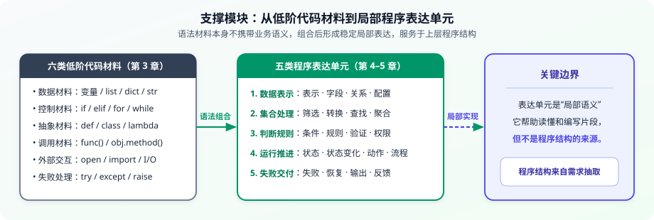

## 本章问题

学会 Python 基础语法之后，依然写不出一个像样的程序。变量、条件、循环、函数、类都背下来了，但打开编辑器面对一个实际问题时，脑子里只有零散的语法碎片。

这个问题的根源在于你把基础语法当成了程序本身。语法不是程序——语法是代码的低阶材料。真正决定程序构造的，是需求、结构、构造件和组装方式。

## 背景：为什么这章重要

基础语法层（Basic Syntax Layer）不是主构造链的一层，而是贯穿所有层的支撑模块。它提供最低阶的实现材料，帮助理解代码如何表达局部含义，但不决定程序的整体结构。

注意这个定位的变化：本书不把语法当作全书的起点（起点是需求场景），也不把语法当作全书的顶点（顶点是可运行系统）。语法只是贯穿全程的低阶工具——它有用，但不应主导你的思考方式。

把基础语法想象成乐高积木。每一块都有固定的形状和连接方式，但单块积木不构成任何有意义的结构。更重要的是：你不需要用积木从零搭建一切——后来你会用到预制的组件（构造件），积木只用来补缺失的部分。

## 核心内容

### 基础语法层的定义

基础语法层是编程语言提供的最底层构造单元集合。每个单元有固定的写法（syntax）和确定的执行行为（semantics）。

| 维度 | 说明 |
|------|------|
| 输入 | 程序员敲出的文本 |
| 输出 | 语言解释器或编译器可识别的指令 |
| 解决的问题 | 让计算机执行单一、原子的操作 |
| 边界 | 单个语法构造不能表达完整的业务含义 |
| 取舍 | 语法越丰富，表达能力越强，但学习曲线越陡 |

### 代码材料的六类分类

基础语法按解决的问题可以分成六类：

#### 数据材料（Data Material）

存储和表示数据的语法构造。

| 构造 | 解决问题 | 输入 | 输出 |
|------|---------|------|------|
| 变量赋值 | 给数据一个名字 | 值 | 可引用的名字 |
| 列表 | 存储有序集合 | 多个值 | 有序序列 |
| 字典 | 存储键值映射 | 键和值 | 可按键查找的映射 |
| 字符串 | 表示文本 | 字符序列 | 不可变文本 |
| 数字 | 表示数量 | 数值 | 可计算的值 |

#### 控制材料（Control Material）

改变程序执行流程的语法构造。

| 构造 | 解决问题 | 输入 | 输出 |
|------|---------|------|------|
| `if / elif / else` | 按条件分支 | 布尔条件 | 选择性执行路径 |
| `for ... in` | 遍历可迭代对象 | 可迭代对象 | 逐元素执行 |
| `while` | 条件循环 | 布尔条件 | 重复执行直到条件为假 |

#### 抽象材料（Abstraction Material）

把一组操作包装成一个可命名单元的语法构造。

| 构造 | 解决问题 | 输入 | 输出 |
|------|---------|------|------|
| `def function()` | 把操作序列命名 | 一组语句 | 可调用的函数 |
| `class ClassName` | 把数据和操作打包 | 字段和方法 | 可实例化的模板 |

#### 调用材料（Call Material）

触发已定义的抽象去执行。

| 构造 | 解决问题 | 输入 | 输出 |
|------|---------|------|------|
| 函数调用 | 执行已定义的函数 | 参数 | 返回值 |
| 方法调用 | 执行对象的方法 | 对象 + 参数 | 返回值 |
| 运算符 | 执行内置运算 | 操作数 | 计算结果 |

#### 外部交互材料（External Interaction Material）

程序与外部世界交换数据的语法构造。

| 构造 | 解决问题 | 输入 | 输出 |
|------|---------|------|------|
| 文件读写 | 持久化数据 | 文件路径 + 模式 | 文件对象 |
| 模块导入 | 加载外部代码 | 模块名 | 模块对象 |
| 输入打印 | 读取用户输入 / 输出结果 | 提示字符串 / 数据 | 用户输入 / 屏幕输出 |

#### 失败处理材料（Failure Handling Material）

程序面对异常情况时保持可控的语法构造。

| 构造 | 解决问题 | 输入 | 输出 |
|------|---------|------|------|
| `try / except` | 捕获并处理异常 | 可能出错的代码块 | 正常或错误分支 |
| `raise` | 主动触发异常 | 异常类型 + 信息 | 中断当前流程 |
| `finally` | 清理资源 | 无论是否异常都执行的代码 | 资源释放 |

### 基础语法层总表

| 类别 | 解决问题 | 核心构造 | 典型输出 |
|------|---------|---------|---------|
| 数据材料 | 存储和表示数据 | 变量、列表、字典、字符串、数字 | 可被其他操作引用的值 |
| 控制材料 | 改变执行流程 | `if`、`for`、`while`、`break`、`continue` | 选择性或重复执行的路径 |
| 抽象材料 | 包装命名操作集 | `def`、`class`、`lambda` | 可调用函数或实例化模板 |
| 调用材料 | 触发已定义的抽象 | `func()`、`obj.method()`、`Class()`、运算符 | 返回值或计算结果 |
| 外部交互材料 | 与程序外部交换数据 | `open()`、`import`、`print()`、`input()` | 文件对象、模块、用户输入 |
| 失败处理材料 | 异常情况保持可控 | `try/except`、`raise`、`finally` | 正常或错误分支执行 |

### 语法材料在全书体系中的位置



语法材料是低阶工具。低阶不等于不重要——它们是你必须熟练使用的基本功，但低阶意味着职责有清晰边界：

1. 语法不能回答“程序要解决什么问题”——那是需求场景层的职责。
2. 语法不能回答“程序应该有什么结构”——那是结构建模层的职责。
3. 语法不能回答“这个需求用什么库或框架实现”——那是构造件层的职责。
4. 语法能回答的只有“这段代码在计算机层面执行了什么原子操作”。

::: {.content-visible when-format="html"}
<div class="pcf-toy" data-toy="ch3-layer-locator"></div>
:::

## 例子与实践

### 场景：语法层在全书体系中的位置

以 Task Manager 中的"创建任务"功能为例，看语法材料在全书中的位置：

```text
需求场景：Member 需要记录新任务 → 需要 create_task 功能
结构建模：Task 对象、create 动作、open 状态、title 字段约束、表单输入边界
构造件选择：FastAPI（后端入口）、Pydantic（输入验证）、SQLAlchemy（数据访问）
胶水代码：连接 FastAPI handler → Pydantic schema → service 函数 → SQLAlchemy 操作

语法材料在这里的位置：
  def create_task(...)       → 抽象材料（函数定义）
  if not title: raise ...    → 控制材料 + 失败处理材料
  db.session.add(task)       → 外部交互材料（数据持久化）
  return TaskResponse(...)   → 调用材料（构造响应）
```

语法材料是最后填充到结构中的东西。它不决定结构，它实现结构。

### 材料分类练习

对一个已有功能代码块，同时说出"这段代码用了哪些代码材料"和"这段代码表达了什么程序含义"。

```python
# 代码
def get_active_tasks(tasks):
    active = []
    for task in tasks:
        if task.status == "in_progress":
            active.append(task)
    return active
```

**材料视角**：抽象材料（函数定义）+ 数据材料（列表变量）+ 控制材料（`for` 循环 + `if` 判断）+ 调用材料（`.append` 方法调用）。

**表达视角**：从任务集合中筛选出状态为 `in_progress` 的任务。

两条答案必须不一样。如果一样，说明思考仍停留在语法层面。

::: {.content-visible when-format="html"}
<div class="pcf-toy" data-toy="ch3-material-xray"></div>
:::

## 小结

基础语法层提供了六类代码材料：数据材料、控制材料、抽象材料、调用材料、外部交互材料、失败处理材料。每一类解决不同的原子操作问题。

但语法不是全书的起点（起点是需求场景），也不是全书的顶点（顶点是可运行系统）。语法是贯穿全程的低阶工具——需要熟练运用，但不能让它主导程序构造的顶层思路。

第 4 章做的事：观察语法组合如何产生稳定的局部程序含义——从低阶材料跨入程序表达。

## 本章产物

完成本章后，你拥有以下可交付产物：

- **基础语法层总表**（六类代码材料汇总）
- **语法材料到表达单元的入口图**（见上文图示）
- **语法与表达双视角区分法**

全书支撑模块汇总见[附录 A：主构造链总表与支撑模块](appendix-a-five-layer-summary.qmd)。

## 从业者输出

学完本章，你应该能完成以下工作：

1. **分类任何语法构造**：看到一段代码，标记出每行属于哪类材料。

2. **填写代码材料分类表**：对一个已有项目，列出使用了哪些数据材料、控制材料、抽象材料、调用材料、外部交互材料、失败处理材料。

3. **区分语法和表达**：对一个已有功能代码块，能同时说出"这段代码用了哪些代码材料"和"这段代码表达了什么程序含义"——两条答案必须不一样。

4. **理解语法的低阶定位**：面对一个需求时，你的第一反应不是"用什么语法实现"，而是"需求是什么结构、用什么构造件承接"——语法是最后填充的细节。
