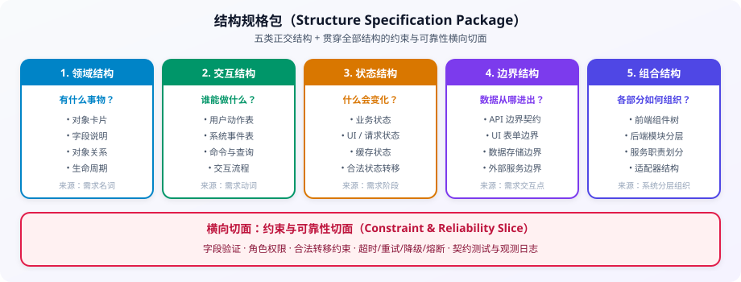
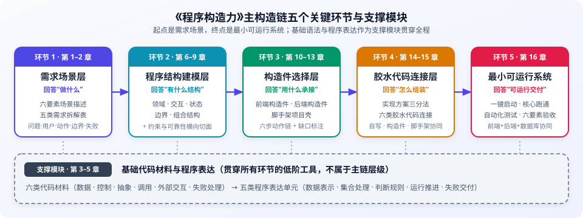

## 本章问题

你有从需求场景拆出来的五类结构初步表——领域、交互、状态、边界、约束。但它们还是散落的。一个完整程序需要的不是散落的结构清单，而是把结构组织成一个整体规格包。这个规格包告诉实现者：程序有什么事物、事物之间怎么交互、状态怎么变化、数据从哪里进入和出去、各部分怎么组合、哪些约束必须保证。

## 背景：为什么这章重要

程序结构建模层（Program Structure Modeling Layer）是全书的核心层。前面两条线汇聚到这里：
- 需求场景层（Part 1）产出了"程序要做什么"的问题描述和六要素
- 基础代码材料与程序表达（Part 2）产出了"低阶代码材料是什么、局部表达是什么"

结构建模层做的事：把需求中的稳定结构抽取出来，产出可被代码、库、框架、组件、脚手架和 AI 生成器消费的结构规格包。

注意和旧模型的关键区别：
- 旧模型认为结构是"表达单元升级出来的"——从 `dict` 升级成对象卡片，从 `if` 升级成规则表
- 新模型认为结构是"从需求抽取出来的"——需求中的名词、动词、阶段、交互点、限制才是结构的来源

表达单元可以作为理解代码的辅助工具，但**不是**结构的来源。结构的来源是需求。

## 核心内容

### 程序结构建模的定义

程序结构建模（Program Structure Modeling）是把需求、场景、对象、动作、状态、边界、组合和约束抽取成结构规格的过程。

| 维度 | 说明 |
|------|------|
| 解决的问题 | 如何把业务需求转化为程序可以承接的结构化规格 |
| 输入 | 第 2 章产出的五类需求拆解表 |
| 输出 | 结构规格包（五类结构 + 一个横向切面） |
| 边界 | 不涉及具体代码实现、框架选择、UI 设计 |
| 取舍 | 结构越精确，实现越明确；过度的结构建模会变成文档负担 |

### 结构规格包：五类结构与一个横向切面

程序结构建模层产出结构规格包，由**五类结构**和**一个横向切面**组成。

#### 1. 领域结构（Domain Structure）

描述程序中的事物：有什么对象、每个对象有什么字段、对象之间怎么关联、对象从创建到销毁经历哪些阶段。

对应需求中的**名词**。

#### 2. 交互结构（Interaction Structure）

描述谁可以做什么：用户动作、系统事件、命令、查询、交互流程。

对应需求中的**动词**。

#### 3. 状态结构（State Structure）

描述什么会变化：状态拥有者、业务状态、UI 状态、请求状态、缓存状态、异步任务状态、状态转移。

对应需求中的**阶段和状态**。

#### 4. 边界结构（Boundary Structure）

描述数据从哪进出：API 边界、UI 边界、数据库边界、文件边界、外部服务边界、消息队列边界、输入输出契约。

对应需求中的**交互点**。

#### 5. 组合结构（Composition Structure）

描述各部分如何组织：组件树、页面结构、模块结构、服务结构、适配器结构、依赖结构。

对应需求中的**分层和组织**。

#### 横向切面：约束与可靠性切面（Constraint & Reliability Slice）

它不是和五类并列的结构，而是贯穿前五类结构的横向切面。每个结构都有对应的约束和可靠性要求。

对应需求中的**限制和失败场景**。

### 结构规格包总览表

| 结构类别 | 解决的问题 | 来源 | 产物形式 |
|---------|-----------|------|---------|
| 领域结构 | 程序有什么事物 | 需求中的名词 | 对象卡片、字段说明、关系表、生命周期 |
| 交互结构 | 谁可以做什么 | 需求中的动词 | 用户动作表、系统事件表、命令/查询定义 |
| 状态结构 | 什么会变化 | 需求中的阶段 | 状态拥有者表、状态转移表 |
| 边界结构 | 数据从哪进出 | 需求中的交互点 | 边界定义表、输入输出契约 |
| 组合结构 | 各部分如何组织 | 需求中的分层 | 组件树、模块结构、服务结构 |
| 约束与可靠性（横向切面） | 哪些限制和保证 | 需求中的限制 | 约束表、可靠性策略表 |

::: {.content-visible when-format="html"}

:::

### 结构建模和代码表达的区别

程序表达单元（Part 2）是局部的、语法层次的。结构建模是整体的、需求层次的。

| 维度 | 程序表达单元 | 程序结构建模 |
|------|-------------|-------------|
| 视角 | 局部——一段代码在表达什么 | 整体——程序有什么结构 |
| 来源 | 语法组合 | 需求抽取 |
| 产物 | 代码含义描述 | 结构规格包 |
| 可消费性 | 程序员读代码时理解 | 可被代码、库、框架、脚手架消费 |
| 包含关系 | 一个表达单元不依赖上下文 | 结构之间互相关联 |

举例：一个筛选表达（`[t for t in tasks if t.status == "open"]`）是表达单元。但"筛选那些状态为 open 的任务"是**领域结构**中的查询规格——它服务于"获取待处理任务列表"这个业务需求。

::: {.content-visible when-format="html"}

:::

### 结构建模层在全书体系中的位置

基础代码材料与程序表达（Part 2）是支撑模块——它们在结构建模和组装中作为低阶工具使用，但不是主链的一层。

## 例子与实践

### 场景：Task Manager 的结构规格包概览

以下是 Task Manager 的结构规格包概览。后续三章分别展开每个细节。

**领域结构**：

| 对象卡片 | 核心字段 | 关系 |
|---------|---------|------|
| Task | id, title, status, priority, due_date, assignee_id | assignee → User, creator → User |
| User | id, name, email, role | tasks → Task[] |
| Project | id, name, description | owner → User, tasks → Task[] |

**交互结构**：

| 动作 | 角色 | 操作对象 |
|------|------|---------|
| create_task | Member | Task |
| assign_task | Manager | Task |
| complete_task | Member | Task |
| approve_task | Manager | Task |

**状态结构**：

| 状态拥有者 | 状态集 | 主转移路径 |
|-----------|--------|-----------|
| Task | open, in_progress, pending_review, done, closed, failed | open → in_progress → pending_review → done |

**边界结构**：

| 边界 | 方向 | 格式 |
|------|------|------|
| API 边界 | 双向 | JSON |
| 数据库 | 存储 | SQLAlchemy |
| 邮件通知 | 输出 | 邮箱格式 |

**组合结构**：

| 层级 | 组件 | 职责 |
|------|------|------|
| API 层 | routers | HTTP 路由 |
| 服务层 | services | 业务逻辑 |
| 数据层 | repositories | 数据访问 |

**约束与可靠性切面**：

| 约束 | 归属 | 处理方式 |
|------|------|---------|
| title 不能为空 | 领域结构 | 验证错误 |
| 只有负责人可完成 | 交互结构 | 权限错误 |
| 数据库失败重试 | 可靠性 | 重试 3 次 |

### 结构规格包检查

一个完整的结构规格包必须能覆盖以下所有条目：

| 检查条目 | 对应结构 |
|---------|---------|
| 列出所有核心事物及其特征和关联 | 领域结构 |
| 列出事物从创建到销毁经历的阶段 | 领域结构 + 状态结构 |
| 列出用户能做的所有操作 | 交互结构 |
| 列出系统自动执行的事件 | 交互结构 |
| 列出所有会变化的内容及其转移路径 | 状态结构 |
| 列出数据的所有出入口 | 边界结构 |
| 列出各部分之间的组织和层级 | 组合结构 |
| 列出必须保证的约束条件 | 约束与可靠性切面 |
| 列出失败场景及处理策略 | 约束与可靠性切面 |

## 小结

程序结构建模层是全书的核心层。它把需求中的名词、动词、阶段、交互点、限制抽取成五类结构与一个横向切面：领域结构、交互结构、状态结构、边界结构、组合结构，加上横向切面约束与可靠性。

这五类结构与一个横向切面不是从表达单元升级出来的，而是从需求抽取出来的。表达单元是理解代码的辅助工具，结构的来源是需求本身。

从下一章开始，逐类展开结构规格包的具体构建方法。第 7 章从最基础的结构开始：领域结构。

## 本章产物

完成本章后，你拥有以下可交付产物：

- **结构规格包概览表**（五类结构 + 一个横向切面）——它是整个 Part 3 的总纲领，也是后续构造件选择和组装的依据。

可复用模板见[附录 B：结构建模模板](appendix-b-structure-modeling-template.qmd)。

## 从业者输出

完成本章后，你能做三件事：

第一，区分“程序表达”和“程序结构”。你知道 `[t for t in tasks if t.status == "open"]` 是一个筛选表达（表达单元），而“任务管理系统需要获取待处理任务列表”是一个领域结构规格。

第二，对一个需求，写出它的结构规格包概览表，完整覆盖对象、动作、状态、边界、组合和约束六项内容。

第三，用“结构规格包检查”清单核验规格包完整性，定位缺失的结构类别并及时补全。

产出物是结构规格包概览表（五类结构 + 一个横向切面）——它是整个 Part 3 的总纲领，也是后续构造件选择和组装的依据。
