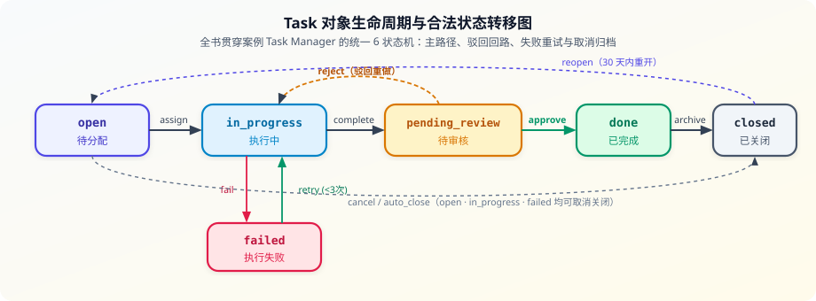

## 本章问题

程序首先要有"事物"——任务、用户、项目、订单。这些事物用什么结构表示？每个事物有什么特征？事物之间怎么关联？事物从创建到销毁经历了什么阶段？这些都是领域结构回答的问题。

## 背景：为什么这章重要

领域结构（Domain Structure）是程序结构建模层的第一类结构，也是最基础的一类。原因是：程序首先要描述"有什么事物"。没有领域结构，交互结构不知道作用在什么对象上，状态结构不知道谁有状态，边界结构不知道数据的类型定义。

领域结构直接来自第 2 章需求拆解中的**名词**。需求中的"任务"变成对象卡片 Task，"标题"变成字段 title，"负责人"变成关系 assignee。

注意：领域结构不包含"配置结构"和"结果结构"。配置结构属于边界结构（涉及运行环境边界），结果结构也属于边界结构（涉及输出边界）。领域结构只关注**业务事物本身**。

## 核心内容

### 对象卡片（Object Card）

对象卡片是领域结构的基本单元。每个对象卡片对应一个核心业务事物。

**解决什么问题**：需求中的名词是口语化的（"任务"、"用户"），程序需要一个精确的定义——这个事物叫什么、有什么职责、有什么字段、跟谁关联、经历什么阶段。

**输入**：第 2 章需求拆解中的名词列表。

**输出**：对象卡片，包含：
- 对象名称和职责描述
- 字段列表（指向字段说明）
- 关系列表（指向对象关系）
- 生命周期（指向状态结构）

对象卡片模板：

```yaml
Object Card: Task
职责: 表示一个待办任务，记录任务内容和状态变化
字段:
  - id: TaskID
  - title: TaskTitle
  - status: TaskStatus
  - priority: Priority
  - due_date: DueDate
关系:
  - assignee: User (0..1)
  - creator: User (1)
  - project: Project (1)
生命周期: TaskLifecycle
```

### 字段说明（Field Spec）

字段说明定义每个字段的类型、约束、默认值和含义。

**解决什么问题**：把需求中的“标题”精确化——明确数据类型、长度上限、必填规则与默认值。

**输入**：需求拆解中的名词特征。

**输出**：字段说明，包含字段名、类型、必填、默认值、约束、含义。

字段说明表模板：

| 字段 | 类型 | 必填 | 默认值 | 约束 | 说明 |
|------|------|------|--------|------|------|
| id | int | 是 | - | 唯一 | 任务编号 |
| title | str | 是 | - | 长度 1-200 | 任务标题 |
| status | enum | 是 | open | open/in_progress/pending_review/done/closed/failed | 任务状态 |
| priority | enum | 是 | medium | low/medium/high/urgent | 优先级 |
| due_date | date | 否 | - | 不早于今天 | 截止日期 |

### 对象关系（Object Relation）

对象关系定义对象之间的关联——方向、数量、生命周期。

**解决什么问题**：需求中的"任务有负责人"需要精确化——一个任务有 0 或 1 个负责人，一个用户可以有多个任务。

**输入**：需求拆解中名词之间的关联描述。

**输出**：对象关系表，包含源对象、目标对象、方向、数量、生命周期。

对象关系表模板：

| 关系名 | 源 | 目标 | 数量 | 方向 | 生命周期 | 说明 |
|--------|---|------|------|------|---------|------|
| assignee | Task | User | 0..1 : 1 | Task → User | SET_NULL | 任务负责人 |
| creator | Task | User | 1 : 1 | Task → User | CASCADE | 任务创建者 |
| owner | Project | User | 1 : 1 | Project → User | CASCADE | 项目负责人 |
| tasks | Project | Task | 1 : 0..N | Project → Task | CASCADE | 项目下的任务 |

::: {.content-visible when-format="html"}
<div class="pcf-toy" data-toy="ch7-relation-cascade"></div>
:::

### 生命周期（Lifecycle）

生命周期描述对象从创建到销毁经历的所有阶段。

**解决什么问题**：一个 Task 创建时处于 `open`，分配后进入 `in_progress`，成员提交后进入 `pending_review`，审核通过进入 `done`，归档或取消进入 `closed`。这些阶段构成生命周期。

**输入**：需求拆解中的阶段列表。

**输出**：生命周期描述，包含状态列表、主路径、分支路径与终止状态。



### 领域约束（Domain Constraint）

领域约束是施加在领域结构上的限制。它们是约束与可靠性切面在领域结构上的具体体现。

**解决什么问题**：需求中的限制需要明确属于哪个对象、哪个字段、哪个关系。

**输入**：第 2 章需求拆解中的限制条目。

**输出**：领域约束表。

| 约束 | 作用对象 | 约束类型 | 违反处理 |
|------|---------|---------|---------|
| title 不能为空 | Task.title | 字段必填 | ValidationError |
| title 不超过 200 字符 | Task.title | 字段长度 | ValidationError |
| priority 必须是枚举值 | Task.priority | 字段取值 | ValidationError |
| due_date 不早于今天 | Task.due_date | 字段范围 | ValidationError (WARN) |
| 一个 Task 必须有 creator | Task.creator | 关系必填 | ValidationError |
| 删除 User 后 Task.assignee 置空 | Task.assignee | 关系生命周期 | SET_NULL |

## 例子与实践

### 场景：Task Manager 的领域结构

Task 对象卡片：

```yaml
Object Card: Task
职责: 待办任务
字段:
  - id: int, 唯一, 自动生成
  - title: str, 长度 1-200, 必填
  - description: str, 长度 0-2000, 可选
  - status: enum, open/in_progress/pending_review/done/closed/failed
  - priority: enum, low/medium/high/urgent
  - due_date: date, 可选
  - created_at: datetime, 自动填充
  - updated_at: datetime, 自动填充
  - assignee_id: int, 可选 (引用 User)
  - creator_id: int, 必填 (引用 User)
  - project_id: int, 必填 (引用 Project)
```

User 对象卡片：

```yaml
Object Card: User
职责: 系统用户
字段:
  - id: int, 唯一, 自动生成
  - name: str, 长度 1-100, 必填
  - email: str, 唯一, 邮箱格式, 必填
  - role: enum, admin/manager/member
  - created_at: datetime, 自动填充
```

Project 对象卡片：

```yaml
Object Card: Project
职责: 任务分组
字段:
  - id: int, 唯一, 自动生成
  - name: str, 长度 1-100, 必填
  - description: str, 可选
  - owner_id: int, 必填 (引用 User)
```

对象关系表：

| 关系 | 源 | 目标 | 数量 | 说明 |
|------|---|------|------|------|
| assignee | Task | User | N:1 | 一个用户可以有多个任务 |
| creator | Task | User | N:1 | 一个用户可以创建多个任务 |
| project | Task | Project | N:1 | 一个项目可以有多个任务 |
| owner | Project | User | N:1 | 一个用户可以有多个项目 |

::: {.content-visible when-format="html"}
<div class="pcf-toy" data-toy="ch7-card-playground"></div>
:::

领域约束表：

| 约束 | 归属 |
|------|------|
| title 必填，1-200 字符 | Task.title |
| priority 必须是 low/medium/high/urgent | Task.priority |
| 创建 Task 时必须有 creator_id | Task.creator_id |
| 删除 User 时关联 Task 的 assignee 置空 | Task.assignee |
| 删除 User 时关联 Task 的 creator 级联 | Task.creator |
| 同一 Project 下的 Task 数量不超过 1000 | Project |

## 小结

领域结构定义了程序中的核心事物——有什么对象、每个对象有什么字段、对象之间怎么关联、对象经历什么生命周期、有什么领域约束。

领域结构的质量决定后续所有结构的质量。如果领域结构错了——对象卡片缺失、字段类型错误、关系方向反了——交互结构、状态结构、边界结构都会跟着错。

第 8 章进入交互结构和状态结构：事物之间怎么相互作用、状态怎么变化。

## 本章产物

完成本章后，你拥有以下可交付产物：

- **对象卡片集合、字段说明表、对象关系表、生命周期图**与**领域约束表**。

可复用模板见[附录 B · 模板 3–6](appendix-b-structure-modeling-template.qmd#模板-3对象卡片)。

## 从业者输出

完成本章后，你能做四件事：

第一，为一个新系统的核心业务对象写出对象卡片。拿到需求后，确定核心对象数量、每个对象的字段清单与对象间关联。

第二，为一组对象卡片写出完整的字段说明表和对象关系表，明确字段类型、约束与默认值，以及关系方向、基数和级联策略。

第三，为核心业务对象绘制完整生命周期，覆盖所有状态、主路径、分支路径与终止状态。

第四，逐项审计领域结构完整度：核对对象卡片覆盖全部业务名词，补齐字段类型与约束，标注关系方向与基数，确认生命周期具备明确终止状态。

产出物是三张表（对象卡片集合、对象关系表、生命周期图）和一份领域约束表。它们直接作为后续交互结构、状态结构和边界结构的输入。
