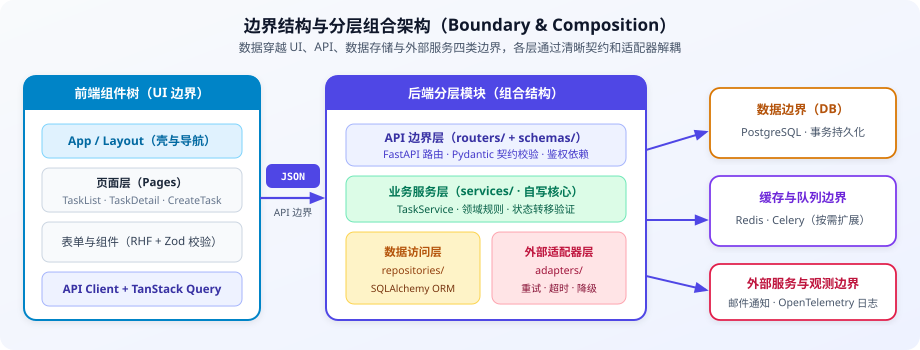

## 本章问题

领域结构定义了有什么事物，交互结构定义了谁做什么，状态结构定义了什么会变化。但还有三个关键问题没有回答：数据从哪些边界进出系统？系统的各部分如何组织在一起？哪些约束必须保证、失败了怎么办？边界结构、组合结构和约束可靠性切面回答的就是这三个问题。

## 背景：为什么这章重要

边界结构（Boundary Structure）、组合结构（Composition Structure）和约束与可靠性切面（Constraint & Reliability Slice）是结构建模层的最后三个组成部分。

**边界结构**定义数据从哪进、从哪出。没有边界结构，你不知道程序的输入格式是什么、输出格式是什么、错误怎么返回。

**组合结构**定义各部分如何组织。没有组合结构，你不知道页面、组件、模块、服务之间的关系。

**约束与可靠性切面**是横向切面——它不是第五类结构，而是贯穿前五类结构的质量保证层。每个结构都有约束和可靠性要求。

注意和旧模型的区别：
- 旧模型把"实现结构"（数据结构说明、函数规格、模块职责）放在结构建模层
- 新模型把实现结构移到 Part 5 组装层——结构建模层只回答"长什么样"，不回答"怎么实现"
- 旧模型把"可靠性结构"作为一个独立类别（异常处理、恢复、输出、反馈、测试）
- 新模型把可靠性作为横向切面——它不从属于任何一个结构，而是每个结构都派生可靠性要求
- 旧模型把"配置结构"和"结果结构"放在领域结构
- 新模型把它们移到边界结构——配置是运行环境边界，结果是输出边界

## 核心内容

### 边界结构（Boundary Structure）

边界结构定义程序与外部世界的所有交互点。

#### API 边界（API Boundary）

程序对外暴露的接口。

| 边界 | 方向 | 协议 | 格式 | 示例 |
|------|------|------|------|------|
| REST API | 双向 | HTTP | JSON | POST /tasks, GET /tasks/{id} |
| WebSocket | 双向 | WS | JSON | 实时通知 |

API 边界规格表：

| API | 方法 | 输入 | 输出(成功) | 输出(失败) |
|-----|------|------|-----------|-----------|
| POST /tasks | Create | {title, description?, priority, due_date?} | {task} | {error, message, violations?} |
| PUT /tasks/{id}/assign | Assign | {user_id} | {task} | {error, message} |
| PUT /tasks/{id}/complete | Complete | {note} | {task} | {error, message} |
| GET /tasks | List | ?status=&priority= | {tasks: []} | {error, message} |

#### UI 边界（UI Boundary）

用户界面接收的输入和展示的输出。

| UI 元素 | 输入 | 输出 | 约束 |
|---------|------|------|------|
| 创建任务表单 | title, description, priority, due_date | JSON 请求体 | 标题必填，1-200 字 |
| 任务列表 | - | 任务卡片列表 | 分页参数 |
| 任务详情 | task_id | 完整任务信息 | - |

#### 数据边界（Data Boundary）

程序与存储系统之间的边界。

| 存储类型 | 操作 | 输入 | 输出 | 技术选择 |
|---------|------|------|------|---------|
| 关系数据库 | CRUD | 查询参数 | 数据行 | SQLAlchemy / Prisma |
| 缓存 | 读写 | 键值对 | 缓存值 | Redis |
| 文件系统 | 读写 | 文件路径 | 文件内容 | 文件 API |

#### 外部服务边界（External Service Boundary）

程序与外部服务的交互。

| 服务 | 交互方式 | 协议 | 失败策略 |
|------|---------|------|---------|
| 邮件服务 | 调用 API | SMTP / HTTP | 重试 3 次，失败降级 |
| 日志服务 | 写入 | stdout / 文件 | 不阻断主流程 |

#### 输入输出契约（Input/Output Contract）

每个边界的输入输出格式定义。

```yaml
# 创建任务 API 契约
POST /tasks
输入:
  title: string (1-200, required)
  description: string (0-2000, optional)
  priority: enum (low/medium/high/urgent, required)
  due_date: string (ISO date, optional)
输出(200):
  task: Task 对象
输出(400):
  error: "VALIDATION_ERROR"
  message: string
  violations: [{field, message}]
输出(500):
  error: "INTERNAL_ERROR"
  message: string
```



::: {.content-visible when-format="html"}
<div class="pcf-toy" data-toy="ch9-boundary-tracer"></div>
:::

### 组合结构（Composition Structure）

组合结构定义系统的各部分如何组织在一起。

#### 组件树（Component Tree）

前端 UI 的层级结构。

```text
App
├── Layout
│   ├── Sidebar
│   └── MainContent
├── TaskListPage
│   ├── FilterBar
│   ├── TaskCard[]
│   └── Pagination
├── TaskDetailPage
│   ├── TaskInfo
│   ├── StatusActions
│   └── CommentSection
├── CreateTaskPage
│   └── TaskForm
└── LoginPage
    └── LoginForm
```

#### 模块结构（Module Structure）

后端代码的层级组织。

```text
src/
├── api/
│   ├── routers/
│   │   ├── task_router.py
│   │   ├── user_router.py
│   │   └── project_router.py
│   └── schemas/
│       ├── task_schema.py
│       └── user_schema.py
├── services/
│   ├── task_service.py
│   ├── user_service.py
│   └── notification_service.py
├── repositories/
│   ├── task_repository.py
│   └── user_repository.py
├── models/
│   ├── task.py
│   └── user.py
└── config.py
```

#### 服务结构（Service Structure）

后端服务的职责划分。

| 服务 | 职责 | 依赖 |
|------|------|------|
| TaskService | 任务 CRUD 和状态管理 | TaskRepository, NotificationService |
| UserService | 用户管理 | UserRepository |
| NotificationService | 通知发送 | 邮件客户端 |
| ValidationService | 输入校验 | 无 |

#### 适配器结构（Adapter Structure）

连接不同层的适配代码。

| 适配器 | 连接 | 职责 |
|--------|------|------|
| API Router | HTTP → Service | 解析请求、调用服务、格式化响应 |
| Repository | Service → Database | CRUD 操作、ORM 映射 |
| Schema | HTTP body → Python dict | 输入验证和序列化 |

### 约束与可靠性切面（Constraint & Reliability Slice）

约束与可靠性不是一个独立的第五类结构，而是贯穿前五类结构的**横向切面**。

每个结构都派生特定的约束和可靠性要求。

#### 从领域结构派生

| 领域元素 | 约束 | 可靠性要求 | 测试类型 |
|---------|------|-----------|---------|
| 字段 | 必填、长度、取值范围 | 验证失败返回明确错误 | 字段边界测试 |
| 关系 | 数量约束、生命周期 | 关系断裂时一致处理 | 关系测试 |
| 生命周期 | 合法状态序列 | 非法转移被拒绝 | 生命周期测试 |

```python
# 领域结构派生的约束
def validate_task_title(title: str):
    if not title or len(title) > 200:
        raise ValidationError("title 1-200 characters")
```

#### 从交互结构派生

| 交互元素 | 约束 | 可靠性要求 | 测试类型 |
|---------|------|-----------|---------|
| 用户动作 | 前置条件 | 前置条件不满足时拒绝 | 用例测试 |
| 系统事件 | 触发条件 | 触发条件不满足时跳过 | 事件测试 |
| 权限 | 角色限制 | 无权限时返回 403 | 权限测试 |

```python
# 交互结构派生的权限约束
def can_complete_task(user: User, task: Task):
    if user.id != task.assignee_id:
        raise PermissionError("只有负责人可以完成任务")
    if task.status != "in_progress":
        raise StateError("任务不在执行状态")
```

#### 从状态结构派生

| 状态元素 | 约束 | 可靠性要求 | 测试类型 |
|---------|------|-----------|---------|
| 状态转移 | 合法转移路径 | 非法转移被拒绝 | 状态转移测试 |
| 并发状态 | 同一对象不能被两个操作同时修改 | 乐观锁或悲观锁 | 并发测试 |

```python
# 状态结构派生的转移约束
def validate_transition(task: Task, target_status: str):
    allowed = {
        "open": ["in_progress", "closed"],
        "in_progress": ["pending_review", "failed", "closed"],
        "pending_review": ["done", "in_progress"],
        "done": ["closed", "open"],
        "closed": ["open"],
        "failed": ["in_progress", "closed"],
    }
    if target_status not in allowed[task.status]:
        raise StateError(f"不能从 {task.status} 转移到 {target_status}")
```

#### 从边界结构派生

| 边界元素 | 约束 | 可靠性要求 | 测试类型 |
|---------|------|-----------|---------|
| 输入校验 | 格式、范围、必填 | 非法输入返回 400 | 输入测试 |
| 输出格式 | 统一响应结构 | 所有输出遵循同一格式 | 输出契约测试 |
| 外部服务 | 超时、重试 | 超时重试、熔断 | 集成测试 |

```python
# 边界结构派生的超时重试策略
def call_with_retry(func, max_retries=3, timeout=5):
    for attempt in range(max_retries):
        try:
            return func(timeout=timeout)
        except TimeoutError:
            if attempt == max_retries - 1:
                raise
            continue
```

#### 从组合结构派生

| 组合元素 | 约束 | 可靠性要求 | 测试类型 |
|---------|------|-----------|---------|
| 服务依赖 | 依赖不为空 | 依赖缺失时快速失败 | 集成测试 |
| 组件接口 | 接口契约 | 接口变更时通知所有使用者 | 契约测试 |
| 目录结构 | 命名规范 | 结构清晰可扩展 | 代码审查 |

### 可靠性策略分类

| 策略 | 适用场景 | 实现方式 |
|------|---------|---------|
| 验证 | 输入到达边界时 | if + raise, schema validation |
| 重试 | 临时性失败（网络、数据库） | retry decorator, 指数退避 |
| 降级 | 非关键路径失败 | 跳过、写日志 |
| 熔断 | 外部服务持续失败 | 暂停请求、快速失败 |
| 超时 | 外部服务响应慢 | timeout 参数 |
| 回滚 | 部分写入成功 | 事务、补偿操作 |
| 日志 | 所有异常情况 | logging, structured log |
| 通知 | 需要人工介入的失败 | 报警、通知 |

::: {.content-visible when-format="html"}
<div class="pcf-toy" data-toy="ch9-reliability-sim"></div>
:::

## 例子与实践

### 场景：Task Manager 的边界、组合与可靠性

**边界结构：API 边界**

| API | 输入校验 | 输出格式 | 错误码 |
|-----|---------|---------|--------|
| POST /tasks | title 必填, priority 枚举 | TaskResponse | 400, 500 |
| PUT /tasks/{id}/assign | task_id 存在, user_id 存在 | TaskResponse | 400, 404, 409, 500 |
| PUT /tasks/{id}/complete | task_id 存在, note 可选 | TaskResponse | 400, 404, 409, 403, 500 |

**组合结构：组件树**

```text
App
├── TaskListPage          → 列表页
├── TaskDetailPage        → 详情页
├── CreateTaskPage        → 创建页
├── LoginPage            → 登录页
└── Layout               → 布局壳
    ├── Header
    ├── Sidebar
    └── MainContent
```

**组合结构：后端模块**

```text
app/
├── api/                  → 边界层
│   ├── routers/
│   └── schemas/
├── services/             → 业务层
├── repositories/         → 数据层
└── models/               → 领域层
```

**可靠性切面：各结构的可靠性要求**

| 所属结构 | 可靠性要求 | 策略 |
|---------|-----------|------|
| 领域 - Task.title | 不能为空，不超长 | 输入验证 |
| 交互 - assign_task | 只有 Manager 可做 | 权限校验 |
| 状态 - status | 只能按合法路径转移 | 转移验证 |
| 边界 - POST /tasks | 非 JSON 格式拒绝 | 格式校验 |
| 边界 - 数据库 | 写入失败重试 | 重试 3 次 |
| 组合 - 通知服务 | 发送失败不阻断主流程 | 降级 + 日志 |

## 小结

边界结构、组合结构和约束可靠性切面完成了结构建模层的最后三个组成部分。

边界结构回答"数据从哪进、从哪出"——API 边界、UI 边界、数据库边界、外部服务边界、输入输出契约。

组合结构回答"各部分如何组织"——组件树、模块结构、服务结构、适配器结构。

约束与可靠性切面是横向贯穿前五类结构的质量保证层——每个结构都派生约束和可靠性要求，而不是把它们当作一个独立的结构类别。

至此，五类结构与一个横向切面全部定义完成。下一章进入 Part 4 构造件层——把结构规格映射到具体的库、框架、组件和脚手架。

## 本章产物

完成本章后，你拥有以下可交付产物：

- **边界定义表、组合结构图、约束与可靠性切面检查表**。

可复用模板见[附录 B · 模板 11–13](appendix-b-structure-modeling-template.qmd#模板-11边界定义表)。


## 从业者输出

完成本章后，你能做四件事：

第一，为一个系统列出所有边界点，并为每个边界点定义输入输出契约。你做出来的契约应该精确到字段级别：每个字段的类型、格式、必填/可选、取值范围。

第二，画出一个系统的组合结构图。你至少能画出组件树（前端层级）、模块结构（后端目录）、服务结构（职责划分）。

第三，为每一类结构派生可靠性要求。你看到"title 字段"时能想到"需要验证"；看到"状态转移"时能想到"需要约束检查"；看到"外部服务调用"时能想到"需要超时和重试"。

第四，区分"可靠性结构"和"可靠性切面"。你知道可靠性不是一个独立的代码模块——它是渗透在所有代码中的约束、验证、重试和降级逻辑。

产出物是边界定义表、组合结构图、可靠性切面检查表。这三份产物加上前三章的产物，构成完整的结构规格包，可以直接进入构造件选择和组装阶段。
