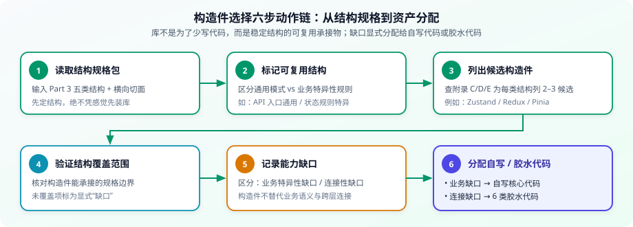

## 本章问题

传统编程教学有一个隐含假设：程序 = 自己写的代码。但现代开发的现实是：程序 = 自写代码 + 构造件 + 胶水代码。构造件——库、框架、组件、SDK、脚手架——已经占据了现代程序的大部分代码量。问题不是"要不要用构造件"，而是"什么结构用哪个构造件、怎么选、怎么接"。

## 背景：为什么这章重要

构造件层（Construction Asset Layer）是全书主构造链中的第三个关键环节，位于程序结构建模之后、胶水代码连接之前。

为什么需要这一层？因为程序结构建模只回答了"程序应该有什么结构"，但没有回答"这些结构用什么代码实现"。而这个问题的答案通常是：**大部分结构已经有现成的构造件可以承接。**

现代程序开发的效率提升，不是因为你写代码更快了，而是因为你用构造件承接了更多结构。

库不是为了少写代码才存在。**库是稳定结构的可复用承接物。**

这句话是构造件层的核心观点。一个库之所以存在，是因为某个程序结构模式反复出现，被提炼成了可复用的代码资产。

这一章不是构造件百科，而是构造件选择的方法论。核心问题是：从结构规格出发，如何一步步选出合适的构造件。

## 核心内容

### 构造件 vs 自己写

| 维度 | 自己写 | 使用构造件 |
|------|--------|-----------|
| 控制力 | 完全控制 | 受限于构造件 API |
| 开发速度 | 慢 | 快 |
| 成熟度 | 需要自己测试 | 已经过大量验证 |
| 维护成本 | 自己维护 | 社区维护 |
| 学习成本 | 无（自己写的） | 需要学习 API |
| 灵活性 | 完全灵活 | 受限于构造件设计 |

### 构造件选择的输入：结构规格包

构造件选择不是凭经验装库，而是读取结构规格包。输入来自 Part 3 的完整输出：

```text
领域结构     → 对象卡片、字段说明、关系表、生命周期
交互结构     → 用户动作表、系统事件表、命令/查询
状态结构     → 状态拥有者表、状态转移表
边界结构     → 边界定义表、输入输出契约
组合结构     → 组件树、模块结构、服务结构
约束与可靠性  → 约束表、可靠性策略表（横向切面）
```

每一类结构都会引出一类或几类候选构造件。例如：状态结构中的"全局共享状态"引出状态库，"服务端数据状态"引出请求库。

::: {.content-visible when-format="html"}
<div class="pcf-toy" data-toy="ch10-build-vs-buy"></div>
:::

### 构造件选择的动作流程



从结构规格到构造件选择的完整动作链：

```text
第一步：读取结构规格包。
  翻开 Part 3 产出的所有结构表，理解每类结构的具体要求。

第二步：标记可复用结构。
  在每类结构中标注哪些是通用模式（已有成熟构造件）、哪些是业务特异性（需要自写代码）。
  例如：API 入口结构 → 通用（FastAPI 可以承接）
  例如：状态转移验证 → 业务特异（需要自写 validate_transition）

第三步：为每个可复用结构列出候选构造件。
  参考附录 C（结构到构造件映射表）和附录 D/E（前端/后端构造件分类表），
  为每个可复用结构列出 2-3 个候选构造件。

第四步：判断构造件是否覆盖结构要求。
  逐一验证候选构造件是否满足结构规格的全部需求。
  不满足的部分标记为"缺口"。

第五步：记录构造件不能覆盖的部分。
  缺口包括：构造件不支持的约束、不满足的性能要求、不兼容的接口风格。
  这些缺口必须由自写代码或胶水代码填补。

第六步：把缺口分配给自写代码或胶水代码。
  业务特异性缺口 → 自写代码（如领域约束、状态转移验证）
  连接性缺口 → 胶水代码（如配置、路由、数据转换、适配器）
```

### 构造件分类总表

| 类别 | 构造件类型 | 承接的结构 | 例子 |
|------|-----------|-----------|------|
| UI 构造件 | 组件库 | 界面展示结构 | MUI, Ant Design, shadcn/ui |
| UI 框架 | 框架 | 组件组合结构 | React, Vue, Svelte |
| 状态构造件 | 状态库 | 状态结构 | Redux, Zustand, Pinia |
| 路由构造件 | 路由库 | 页面流转结构 | React Router, Vue Router |
| 请求构造件 | 请求库 | 服务端数据状态 | TanStack Query, SWR |
| 表单构造件 | 表单库 | 输入交互结构 | React Hook Form |
| 验证构造件 | 验证库 | 字段约束结构 | Zod, Yup, Pydantic |
| 后端入口构造件 | Web 框架 | API 入口结构 | FastAPI, Express, Spring Boot |
| 数据访问构造件 | ORM | 数据访问结构 | SQLAlchemy, Prisma, TypeORM |
| 权限构造件 | 权限库 | 权限结构 | Auth middleware |
| 任务构造件 | 队列库 | 异步任务结构 | Celery, BullMQ |
| 缓存构造件 | 缓存库 | 缓存结构 | Redis client |
| 观测构造件 | 观测库 | 日志观测结构 | OpenTelemetry |
| 测试构造件 | 测试框架 | 测试验证结构 | pytest, Vitest, Playwright |
| 脚手架构造件 | 脚手架 | 工程壳结构 | Vite, Next.js, create-app |

### 结构到构造件映射表

| 结构问题 | 可选构造件 | 需要补的胶水代码 |
|---------|-----------|---------------|
| 需要页面流转 | React Router / Vue Router | 路由配置、页面组件 |
| 需要 UI 组件 | MUI / Ant Design / shadcn/ui | 主题配置、样式覆盖 |
| 需要全局状态 | Redux / Zustand / Pinia | store 定义、状态切片 |
| 需要服务端数据 | TanStack Query / SWR | 查询钩子、缓存配置 |
| 需要表单输入 | React Hook Form | 表单注册、验证规则 |
| 需要输入验证 | Zod / Yup / Pydantic | schema 定义、错误消息 |
| 需要 API 入口 | FastAPI / Express | 路由注册、中间件配置 |
| 需要数据访问 | SQLAlchemy / Prisma | 模型定义、迁移脚本 |
| 需要任务队列 | Celery / BullMQ | 任务定义、worker 配置 |
| 需要项目壳 | Vite / Next.js / create-app | 目录结构、构建配置 |

### 构造件边界

构造件能大幅提升开发效率，但它不是万能的。以下五条原则说明构造件不做什么：

```text
构造件不替代业务语义。
  MUI 提供了按钮组件，但不替代"审核按钮在 pending_review 状态才可用"的业务规则。

构造件不替代领域规则。
  SQLAlchemy 提供了数据持久化，但不替代"task 状态必须按合法路径转移"的领域约束。

构造件不完成跨层连接。
  FastAPI 和 SQLAlchemy 各自独立工作，它们之间的依赖注入和数据转换需要自己写。

构造件不替代结构建模。
  装了一堆库但没有结构规格，代码最终会变得难以维护。构造件选择在结构建模之后。

构造件只承接稳定结构。
  通用模式有构造件承接，业务特异性需求没有——这是自写代码的存在理由。
```

## 例子与实践

### 场景：Task Manager 的构造件选择

以下是应用六步动作链为 Task Manager 选择构造件的完整过程：

**第一步：读取结构规格包。**
输入 Part 3 所有结构表：Task/User/Project 对象卡片、用户动作表（create/assign/complete/approve）、状态转移表（6 个状态 + 8 条转移）、API 边界表（5 个 API）、组合结构表（前端组件树 + 后端模块结构）。

**第二步：标记可复用结构。**

| 结构 | 可复用判定 | 判定依据 |
|------|-----------|---------|
| API 入口结构 | 可复用 | 标准的 REST API 模式，框架可承接 |
| 数据访问结构 | 可复用 | CRUD + 关系查询，ORM 可承接 |
| UI 展示结构 | 可复用 | 标准按钮、表格、卡片，组件库可承接 |
| 页面流转结构 | 可复用 | 多页面 URL 切换，路由库可承接 |
| 领域约束（状态转移） | 业务特异 | 每个应用的状态规则不同，需要自写 |
| 权限规则 | 业务特异 | 角色和操作权限因业务而异 |

**第三步到第六步：列出候选、判断覆盖、记录缺口、分配。**

| 结构需求 | 选中构造件 | 构造件覆盖的部分 | 缺口（自写/胶水） |
|---------|-----------|----------------|----------------|
| 前端框架 | React | 组件组合、状态管理、事件处理 | - |
| 前端脚手架 | Vite | 构建配置、HMR、TypeScript | - |
| UI 组件库 | MUI | 按钮、表格、卡片、对话框 | 业务组件（TaskCard、StatusBadge）→ 自写 |
| 路由 | React Router v6 | 页面 URL 切换、参数传递 | 路由守卫（权限检查）→ 胶水 |
| 全局状态 | Zustand | 跨组件状态共享 | 状态持久化 → 胶水 |
| 服务端数据 | TanStack Query | 缓存、loading/error 状态、自动刷新 | 查询键管理 → 胶水 |
| 表单 | React Hook Form | 字段注册、提交处理 | MUI 组件适配（Controller）→ 胶水 |
| 验证 | Zod | 类型推导、运行时验证 | 自定义错误消息 → 胶水 |
| 后端框架 | FastAPI | 路由、请求解析、自动文档 | CORS 配置 → 胶水 |
| ORM | SQLAlchemy | 模型映射、查询、关系加载 | 迁移脚本 → 脚手架 |
| 测试 | pytest + Vitest | 测试运行器、断言、fixture | 测试用例数据 → 自写 |

## 小结

构造件层是全书主构造链的枢纽层。它把结构规格翻译成具体的代码资产选择。

选择构造件的核心动作链：读取结构规格包 → 标记可复用结构 → 列出候选构造件 → 判断覆盖范围 → 记录缺口 → 分配给自写代码或胶水代码。

构造件只承接稳定结构，不替代业务语义、领域规则、跨层连接和结构建模。

接下来的三章展开三类构造件：前端构造件（第 11 章）、后端构造件（第 12 章）、脚手架（第 13 章）。

::: {.content-visible when-format="html"}
<div class="pcf-toy" data-toy="ch10-six-step-wizard"></div>
:::

## 本章产物

完成本章后，你拥有以下可交付产物：

- **六步构造件选择动作链**（可复用于任何项目的流程）
- **构造件分类总表**（15 类构造件及其承接的结构）与 **5 条构造件边界原则**
- **结构到构造件映射表**（标注选中构造件、覆盖范围与缺口）

可复用模板见[附录 B · 模板 14](appendix-b-structure-modeling-template.qmd#模板-14结构到构造件映射表)与[附录 C：结构到构造件映射表](appendix-c-structure-to-asset-mapping.qmd)。

## 从业者输出

完成本章后，你能做三件事：

第一，对任意一个你正在用的库，说清楚它承接了什么程序结构。用了 React Router？你知道它承接了页面流转结构。用了 TanStack Query？你知道它承接了服务端数据状态结构。

第二，对一个已有的结构规格包，执行六步选择流程：读取结构规格 → 标记可复用结构 → 列候选 → 判断覆盖 → 记录缺口 → 分配自写/胶水。产出物是一份带覆盖范围和缺口标记的构造件选择表。

第三，知道构造件的边界——不会因为装了构造件就认为业务逻辑不用写了。能区分"构造件覆盖了通用结构"和"自写代码需要填补业务特异性缺口"。

产出物是一份结构到构造件映射表，标注每种结构选了哪个构造件以及需要补的胶水代码。
