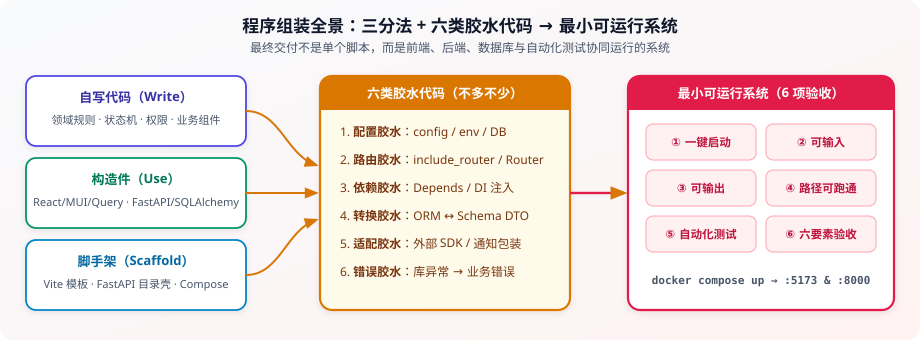

## 本章问题

你有了结构规格（Part 3）、构造件选择（Part 4）、实现方案（第 14 章）和胶水代码设计（第 15 章）。现在是时候把所有东西收拢成一个真正可运行的系统。这个系统不一定要功能齐全——它只需要满足最小可运行标准：能启动、能输入、能输出、能运行、能测试、能证明它真的可用。

## 背景：为什么这章重要

"能运行"是程序从设计进入交付的门槛。前面的所有工作——需求场景、结构建模、构造件选择、实现方案、胶水设计——都是为了这一刻。

最小可运行系统（Minimum Runnable System）是全书的最终产出。不是"最小可运行程序"——程序是单个单元的代码产出，**系统是多层构造件和代码的协同运行结果**。

为什么强调"系统"而不是"程序"：
- 程序是一个可执行文件或脚本
- 系统是多个程序、服务、库、框架、数据库、缓存、任务队列的协同整体

本书的目标不是一个 Python CLI 脚本，而是一个有前端、后端、数据库、API、状态管理、测试的完整系统。

## 核心内容

### 最小可运行系统的六个验收标准

| 标准 | 含义 | Task Manager 的答案 |
|------|------|-------------------|
| 能启动 | 系统可以通过命令启动 | `docker-compose up` |
| 能输入 | 可以向系统输入数据 | 通过 API 或 UI 创建任务 |
| 能输出 | 系统能返回结果 | API 返回 JSON，UI 展示页面 |
| 能运行 | 核心业务逻辑可执行 | 创建→分配→完成→审核可跑通 |
| 能测试 | 系统有自动化测试 | pytest + Vitest 测试通过 |
| 能验收 | 能证明系统满足需求 | 六要素场景可验证 |

以下代码用于展示系统结构的落地形式，不代表完整生产配置。

### 从结构到系统的回收

主构造链五个关键环节与支撑模块的最终产物在最小可运行系统中完成闭环回收：



### 启动入口设计

系统需要一键启动。

```yaml
# docker-compose.yml — 系统启动入口（最小核心路径）
# 注意：Redis 缓存、Celery worker 等扩展运行结构不在此处，见"扩展运行结构"
version: "3.8"
services:
  db:
    image: postgres:16
    environment:
      POSTGRES_DB: taskmanager
      POSTGRES_USER: app
      POSTGRES_PASSWORD: secret
    ports:
      - "5432:5432"

  backend:
    build: ./backend
    environment:
      DATABASE_URL: postgresql+asyncpg://app:secret@db:5432/taskmanager
    ports:
      - "8000:8000"
    depends_on:
      - db

  frontend:
    build: ./frontend
    ports:
      - "5173:5173"
    depends_on:
      - backend
```

**扩展运行结构**（非最小核心路径，按需启动）：

```yaml
# docker-compose.override.yml
services:
  redis:
    image: redis:7
    ports:
      - "6379:6379"

  worker:
    build: ./backend
    command: celery -A app.tasks worker
    depends_on:
      - redis
    profiles:
      - extended
```

```bash
# 一键启动命令
docker-compose up

# 前端访问
open http://localhost:5173

# API 文档
open http://localhost:8000/docs
```

### 核心业务流程验证

确认系统的核心业务路径可运行。

```python
# 测试：完整业务流程
@pytest.mark.asyncio
async def test_full_task_lifecycle(async_client):
    # 1. 创建任务
    response = await async_client.post("/api/tasks", json={
        "title": "测试任务",
        "priority": "high",
    })
    assert response.status_code == 201
    task = response.json()
    assert task["status"] == "open"
    task_id = task["id"]

    # 2. 分配任务
    response = await async_client.put(f"/api/tasks/{task_id}/assign", json={
        "user_id": 1,
    })
    assert response.status_code == 200
    assert response.json()["status"] == "in_progress"

    # 3. 完成任务
    response = await async_client.put(f"/api/tasks/{task_id}/complete", json={
        "note": "已完成",
    })
    assert response.status_code == 200
    assert response.json()["status"] == "pending_review"

    # 4. 审核通过
    response = await async_client.put(f"/api/tasks/{task_id}/approve")
    assert response.status_code == 200
    assert response.json()["status"] == "done"
```

### 验收检查：需求场景六要素验证

回到第 1 章的需求场景，逐项核验最小可运行系统对六要素的覆盖情况：

| 要素 | 需求场景 | 系统验证 |
|------|---------|---------|
| 问题 | 团队缺乏统一任务追踪 | 系统可创建、分配、追踪任务 ✓ |
| 用户 | Member, Manager, Admin | 角色可创建、分配、审核 ✓ |
| 动作 | 创建、分配、完成、审核 | API 和 UI 支持所有核心动作 ✓ |
| 输入 | 标题、描述、优先级、截止日期 | 所有输入字段已实现 ✓ |
| 输出 | 任务对象、错误响应 | API 返回标准格式 ✓ |
| 失败 | 验证错误、状态冲突、系统失败 | 验证、权限、重试已实现 ✓ |

### 最小可运行系统检查表

```text
启动检查：
[✓] 系统可以通过一个命令启动
[✓] 前端启动成功，可访问
[✓] 后端启动成功，API 可调用
[✓] 数据库连接正常

功能检查（核心路径）：
[✓] 创建任务 → open
[✓] 分配任务 → in_progress
[✓] 完成任务 → pending_review
[✓] 审核任务 → done
[✓] 查看任务列表
[✓] 查看任务详情

功能检查（异常路径）：
[✓] 标题为空 → 400
[✓] 用户不存在 → 404
[✓] 状态转移非法 → 409
[✓] 无权限操作 → 403

测试检查：
[✓] 后端测试通过（pytest）
[✓] 前端测试通过（Vitest）
[✓] 核心业务流程测试通过

系统边界：
[✓] API 输入验证
[✓] 统一错误响应格式
[✓] 数据库连接错误处理
[✓] 外部服务超时处理

交付物：
[✓] 完整代码仓库
[✓] 启动文档
[✓] API 文档（OpenAPI）
[✓] 核心流程测试
```

## 例子与实践

### 场景：Task Manager 的最小可运行系统

**启动方式**：

```bash
# 本地开发
# 终端 1：启动后端
cd backend && uvicorn app.main:app --reload

# 终端 2：启动前端
cd frontend && npm run dev

# 终端 3（扩展运行结构）：启动 worker（如果有异步任务需要）
# cd backend && celery -A app.tasks worker --loglevel=info

# 全栈 Docker 方式
docker-compose up
```

**核心业务路径验证**：

```bash
# 1. 创建任务
curl -X POST http://localhost:8000/api/tasks \
  -H "Content-Type: application/json" \
  -H "Authorization: Bearer <token>" \
  -d '{"title": "实现登录功能", "priority": "high"}'
# → 201 {"id": 1, "title": "实现登录功能", "status": "open"}

# 2. 分配任务
curl -X PUT http://localhost:8000/api/tasks/1/assign \
  -H "Content-Type: application/json" \
  -H "Authorization: Bearer <token>" \
  -d '{"user_id": 2}'
# → 200 {"id": 1, "status": "in_progress", "assignee_id": 2}

# 3. 完成任务
curl -X PUT http://localhost:8000/api/tasks/1/complete \
  -H "Content-Type: application/json" \
  -H "Authorization: Bearer <token>" \
  -d '{"note": "已完成登录功能"}'
# → 200 {"id": 1, "status": "pending_review"}

# 4. 审核通过
curl -X PUT http://localhost:8000/api/tasks/1/approve \
  -H "Authorization: Bearer <token>"
# → 200 {"id": 1, "status": "done"}

# 5. 验证：查看任务列表
curl http://localhost:8000/api/tasks
# → {"tasks": [{"id": 1, "title": "实现登录功能", "status": "done", ...}]}
```

**前端验证**：打开 `http://localhost:5173`，可以：
- 看到任务列表页面
- 点击"创建任务"按钮，填写表单，创建新任务
- 点击任务卡片进入详情页
- 在详情页中执行分配、完成、审核操作
- 操作后页面自动刷新显示最新状态

**测试验证**：

```bash
# 后端测试
cd backend && pytest -v
# → 全部通过

# 前端测试
cd frontend && vitest run
# → 全部通过
```

### 主构造链五个关键环节与支撑模块的总回收

```text
主构造链五个关键环节：

需求场景层（第 1-2 章）
  → Task Manager 需求六要素
  → 五类需求拆解表

程序结构建模层（第 6-9 章）
  → 领域结构：Task, User, Project 对象卡片
  → 交互结构：create, assign, complete, approve 动作
  → 状态结构：open → in_progress → pending_review → done
  → 边界结构：API 边界、输入输出契约
  → 组合结构：组件树、后端模块
  → 可靠性切面：验证、权限、重试

构造件选择层（第 10-13 章）
  → 前端：Vite + React + MUI + React Router + Zustand + TanStack Query + RHF + Zod
  → 后端核心路径：FastAPI + SQLAlchemy + pytest
  → 后端扩展运行结构：Celery + Redis + OpenTelemetry
  → 脚手架：Vite React TS 模板、FastAPI 项目结构

胶水代码连接层（第 14-15 章）
  → 实现方案：自写 + 构造件 + 脚手架三分法
  → 胶水代码：配置、路由、依赖、数据转换、适配器、错误处理

最小可运行系统层（第 16 章）
  → docker-compose up 一键启动的完整系统

支撑模块（第 3-5 章，贯穿主链）：
  → 基础代码材料与程序表达
  → 语法材料分类、表达单元
```

::: {.content-visible when-format="html"}
<div class="pcf-toy" data-toy="ch16-mrs-runner"></div>
:::

::: {.content-visible when-format="html"}
<div class="pcf-toy" data-toy="ch16-five-layer-recap"></div>
:::

## 小结

最小可运行系统是全书的最终产出。它不是一个 Python CLI 脚本，而是一个有前端、后端、数据库、API 与自动化测试的完整系统。

六个验收标准：能启动、能输入、能输出、能运行、能测试、能验收。

主构造链五个关键环节与支撑模块的所有产物最终回收在系统中：

- 需求场景决定系统的价值
- 结构建模决定系统的骨架
- 构造件选择决定系统的实现效率
- 胶水代码决定系统各部分如何连接
- 最小可运行系统是这一切的输出

这本书不是教你从语法堆出程序——而是教你从需求出发，通过结构建模、构造件选择和胶水代码组装，把想法变成可运行系统。

## 本章产物

完成本章后，你拥有以下可交付产物：

- **可一键启动的最小可运行系统**（前端 + 后端 + 数据库 + 自动化测试）
- **最小可运行系统验收检查表**
- **可复用于下一个项目的五层主构造链方法**

完整验收清单见[附录 F：最小可运行系统检查表](appendix-f-minimum-runnable-system-checklist.qmd)。

## 从业者输出

完成本章后，你能做六件事：

第一，启动一个完整的前端 + 后端系统。用一条命令（`docker compose up`）启动整个系统并验证所有服务健康运行。

第二，执行核心业务流程。通过 API 或 UI 跑通“创建 → 分配 → 完成 → 审核”并验证每一步输出。

第三，运行自动化测试。运行 pytest 和 Vitest 套件，确认核心与异常路径测试全部通过。

第四，使用最小可运行系统检查表完成交付验收，逐项核验启动、功能、测试、边界与交付物。

第五，诊断系统启动问题。如果服务启动失败，你能定位是数据库连接问题、配置问题还是依赖缺失问题。

第六，把书中的五层方法应用到下一个项目。你不再从语法开始，而是从需求场景开始，经过结构建模、构造件选择、胶水代码组装，最终形成最小可运行系统。

产出物是一个可运行的系统、一份系统检查表、以及一套可以复用于下一个项目的五层方法。
