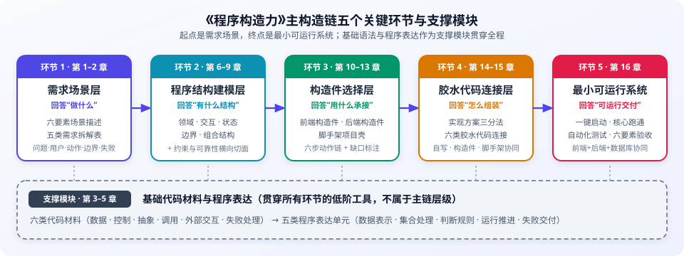

# 序言 {.unnumbered}

学完基础语法之后，然后呢？

这是每个编程学习者都会遇到的问题。你会写 `for` 循环，会用 `if` 做判断，知道 `dict` 可以存键值对——但面对一个真实需求时，依然不知道从哪里下手。

问题不在语法，而在于**语法只是材料，不是蓝图**。

这本书从一个更根本的问题出发：**拿到一个需求后，如何把它变成可运行的系统？**

答案不是“用语法一行行堆出程序”。**程序构造力**的核心在于：把需求中的对象、动作、状态、边界、组合和约束抽取成结构模型，再选择自写代码、库、框架、组件、脚手架或 AI 生成器来承接这些结构，最后用最少的胶水代码组装成最小可运行系统。

你不需要从零编写每一行代码。读完本书，你会建立一套完整的工程动作链：

- **拆解需求**：把模糊的业务语言拆成对象、动作、状态、边界和约束。
- **结构建模**：产出可被代码、构造件和脚手架消费的结构规格包。
- **选择构造件**：判断哪些结构自己写、哪些交给前后端库、框架、组件或脚手架。
- **胶水组装**：用最少且清晰的胶水代码把各部分接通，验收最小可运行系统。

::: {.callout-note title="关于支撑模块（第 3–5 章）的定位"}
本书主构造链包含五个关键环节：**需求场景 → 程序结构建模 → 构造件选择 → 胶水代码连接 → 最小可运行系统**。基础代码材料与程序表达（Part 2，第 3–5 章）不是主链的一层，而是贯穿所有环节的支撑模块——帮助你读懂代码如何表达局部语义，但不决定程序的整体结构。
:::

全书将围绕一个贯穿始终的真实案例——**任务管理系统（Task Manager）**，从需求场景一路走到一键启动的最小可运行系统。每一章还配套了浏览器端交互实验，帮助你通过单步调试、参数调节与策略对比把抽象概念变成肌肉记忆。
